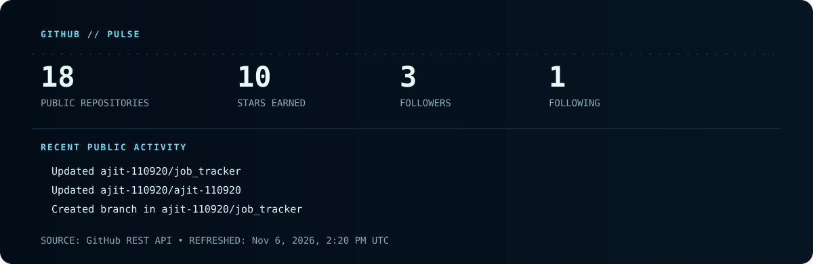

<p align="center">
  
</p>

<p align="center">
  <a href="https://www.linkedin.com/in/ajit-bhandekar/"></a>
  
</p>

> `SYSTEM / AJIT` — Computer Engineering student exploring the space between data, models, and reliable products.

<p align="center">
  
</p>

## `01` / Signal

I am a Computer Engineering student in Pune, building toward machine-learning engineering through hands-on projects. My current work combines data cleaning, exploratory analysis, classical machine learning, and practical deployment. The goal is simple: turn a useful model into a product someone can actually use.

```text
NOW EXPLORING  →  scikit-learn • data workflows • AWS deployment • DSA
BUILD MODE     →  Python systems with clear, testable data paths
NEXT HORIZON   →  ML engineering that ships real products
```

## `02` / Build Log

| Project | Mission | Working stack |
| --- | --- | --- |
| **Diabetes Prediction System** | Make an ML prediction accessible through a real-time web application. | Python · Pandas · scikit-learn · Streamlit · AWS |
| **Credit Card Fraud Detection** | Explore transaction data and identify suspicious activity with ML models. | Python · data cleaning · machine learning |
| **Data Analysis Projects** | Turn raw datasets into clear visual stories and actionable observations. | Pandas · Matplotlib · Seaborn |

## `03` / Toolchain

<p align="center">
  
</p>

<p align="center"><sub>Data &amp; ML / Python + pandas + scikit-learn &nbsp;&nbsp; • &nbsp;&nbsp; Foundations / C, C++, DSA &nbsp;&nbsp; • &nbsp;&nbsp; Delivery / Git, AWS, Linux</sub></p>

## `04` / GitHub Pulse

<p align="center">
  
</p>

<p align="center"><sub>Generated from public GitHub data by this repository’s scheduled workflow. Last refresh is embedded in the card.</sub></p>

## `05` / Learning Queue

```text
[ACTIVE]  Machine learning with scikit-learn
[ACTIVE]  AWS deployment
[ACTIVE]  Data structures & algorithms
[LOADING]  Production-minded backend and data systems
```

---

<p align="center"><i>Build carefully. Learn in public. Make the next model useful.</i></p>

<details>
<summary><strong>Profile automation &amp; configuration</strong></summary>

<br />

`.github/workflows/refresh-profile.yml` refreshes `assets/github-pulse.svg` every Monday and can also be run manually from the **Actions** tab. It uses the repository’s automatically provided `GITHUB_TOKEN`; no custom secret or third-party API key is required.

For the workflow to commit its updated card, enable **Settings → Actions → General → Workflow permissions → Read and write permissions** in this repository. The workflow is deliberately configured to make a commit only when the generated SVG changed. To preview the same card locally, run `node scripts/refresh-profile.mjs` from the repository root. Set `GITHUB_USERNAME` only if you fork this profile repository for another account.

</details>
